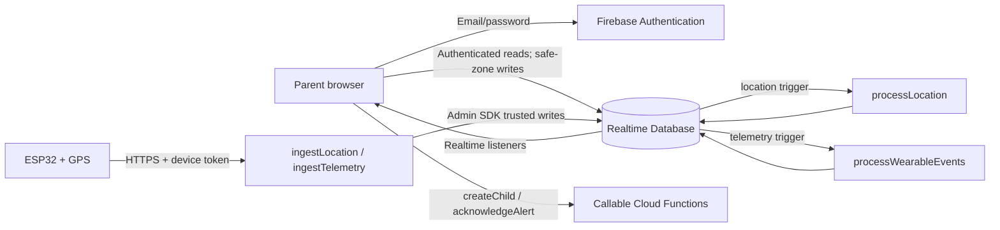

# ChildLink — Project Documentation and Team Handover

**Prepared from the current repository.** This report describes source code and local test results; it does not claim a live Firebase or physical-device test.

## Current project status

The physical wearable is not available for our own end-to-end test. The team reports that an engineer previously tested the device, but we have not reverified that the flashed firmware matches the code and configuration in this repository.

The repository contains the parent web application, Firebase client setup, Realtime Database rules, Cloud Functions source, ESP32 sketch, setup templates, and local tests. The focused tests and JavaScript syntax checks have run locally. They use a mocked Firebase transport for backend workflows and do not prove that the real Firebase project or Functions are reachable.

Live Firebase authentication and database access, deployed Functions, real GPS delivery, and physical SOS behavior remain unverified. Having the wearable available will enable the physical tests, but will not by itself guarantee success: project settings, permissions, deployment, the device token, Wi-Fi, the server certificate, and compatibility with the actual board must also be correct.

| Status category | What can be said from this repository |
|---|---|
| Implemented in code | Email/password UI flow, parent-child association through `createChild`, database listeners, maps, safe-zone editing, location history, geofence and SOS Functions, and ESP32 request code are present. |
| Verified locally | The current Node test command passes. JavaScript syntax checks passed. The backend tests substitute an in-memory mock for Firebase. |
| Configured, not verified | The source names project `smartgrid-abc67`, its Realtime Database URL, Function runtime, rules, and endpoint URLs. Current Console values and deployed state were not verified. |
| Requires Firebase access/deployment | Real sign-in, database permissions/data, parent-child records, deployed Functions, and Cloud Function triggers. |
| Requires hardware/engineer confirmation | Actual firmware version, board and GPS wiring, SOS button GPIO/wiring, Wi-Fi setup, CA provisioning, and real GPS/SOS delivery. |

## 1. One-page overview

ChildLink is intended to let a parent sign in, link a child profile to their account, see the latest point sent by an ESP32 GPS wearable, manage safe zones, review location history, and receive SOS or zone-transition alerts.

The web page does not receive GPS directly from the ESP32. The device sends HTTPS requests to two public HTTP Cloud Function endpoints. Each request includes a per-child device token in the `X-ChildLink-Token` header. The Functions verify the token against a stored hash, then use the trusted Firebase Admin SDK to update the database. A database trigger processes new points and telemetry. The browser signs in with Firebase Authentication and listens to the records it is allowed to read.



The diagram is the intended architecture from source. It does not mean any cloud function is currently deployed or that the physical flow has passed an end-to-end test.

## 2. File inventory

The inventory below covers repository-maintained files and generated/dependency folders found at inspection time. There is no separate image, font, or map-tile asset folder; the browser loads Firebase SDK and Leaflet from external CDNs, and requests OpenStreetMap tiles.

| File or folder | Category | Purpose and status |
|---|---|---|
| `web/index.html` | Frontend | Page structure, forms, navigation, map containers, panels, and accessible status containers. |
| `web/styles.css` | Frontend | Responsive visual styles for sign-in, cards, maps, forms, navigation, status, and mobile layouts. |
| `web/app.js` | Frontend | Firebase initialization, auth handlers, database listeners, view rendering, map updates, child setup, safe-zone writes, history, and alerts. |
| `web/firebase-config.js` | Configuration | Browser Firebase project settings. It contains a public web-app configuration value; it must not contain service-account credentials or device tokens. The report intentionally does not reproduce the key. |
| `web/location-state.mjs` | Frontend logic | Coordinate normalization, freshness/status decisions, labels, and friendly Firebase read errors. |
| `functions/index.js` | Backend | Callable setup/acknowledgement functions, device HTTP receivers, and database triggers. |
| `functions/geofence.js` | Backend logic | Distance calculation and hysteresis-aware zone-transition classification. |
| `functions/package.json` | Configuration/dependencies | Node engine, Firebase dependencies, and test scripts for Functions. |
| `functions/package-lock.json` | Dependency lockfile | Pins dependency resolution for repeatable installation/deployment. It is generated by npm and is not application logic. |
| `functions/smoke_test.js` | Tests | Mocked backend workflow covering child setup, device validation, location/history, telemetry/SOS, and alert acknowledgement. |
| `functions/location_state_test.mjs` | Tests | Focused tests for coordinate parsing, timestamps, freshness states, invalid points, and Firebase read-error messages. |
| `ChildGadgetFyp.ino` | Hardware firmware | ESP32 GPS, Wi-Fi, HTTPS location and heartbeat transmission, and optional SOS button logic. |
| `ChildLinkDeviceConfig.h.example` | Configuration template | Names the local Wi-Fi, child ID, one-time device token, root CA, and optional SOS GPIO settings expected by the sketch. |
| `database.rules.json` | Security configuration | Realtime Database ownership, read/write, validation, and history index rules. |
| `firebase.json` | Firebase configuration | Points Firebase CLI at rules, Functions source/runtime, Hosting directory, and local emulator ports. |
| `.firebaserc` | Firebase project config | Sets `smartgrid-abc67` as the CLI default project. This does not authenticate the CLI or prove deployment. |
| `.gitignore` | Repository hygiene | Excludes local Python cache, private `ChildLinkDeviceConfig.h`, Firebase local state, and installed Functions dependencies. |
| `local_simulator.py` | Local development utility | Serves the static `web/` files on loopback; it is not a GPS simulator or Firebase emulator. |
| `README.md` | Documentation | Short setup, data-path, firmware, deployment, and test notes. This handover expands on it. |
| `firebase-debug.log` | Generated diagnostic file | Firebase CLI debug output, not runtime application code. Treat as local diagnostic material and inspect before sharing because CLI logs can include environment details. |
| `functions/node_modules/` | Installed dependencies | Third-party Node packages installed from the lockfile; not project-written source. |
| `__pycache__/` (if regenerated) | Generated files | Python bytecode cache; not needed to explain or run the web application. |

No root-level `package.json`, `.env` file, or private `ChildLinkDeviceConfig.h` was present in the inspected inventory. No separate test runner is configured for browser UI or firmware.

## 3. Components and important code

### 3.1 Browser application

#### `web/index.html`

This is the page skeleton. It contains:

- The sign-in/register form (`auth-form`, `email`, `password`, `auth-mode`) and an error region.
- No demo account, simulated location, or fake SOS view. The app reads account and device data only from Firebase.
- The authenticated application shell: Home, Map/Tracking, Safe Zones, and Alerts views.
- The account home has no child-onboarding card; the legacy root location displays as `Fahad` when there are no linked children.
- Map containers for the home overview, full tracking view, and safe-zone selection.
- Safe-zone fields for name, latitude, longitude, and radius.
- Location-history date filters and a load-older control.
- The Leaflet stylesheet/script and the ES module `app.js`.

The HTML does not itself authenticate users or read data; it provides IDs and form elements that `app.js` controls. A missing element ID used by the script would break the associated interaction.

#### `web/styles.css`

This file defines the visual system and responsive layout: colors, cards, forms, button variants, map sizes, alerts, zones, and small-screen navigation. It is presentation-only; it does not validate Firebase permissions or create data. It imports no project-maintained image assets. External font fallback uses system fonts.

#### `web/firebase-config.js`

Exports the Firebase web-app configuration consumed by `app.js`. The source identifies project `smartgrid-abc67`, the `smartgrid-abc67-default-rtdb` Realtime Database URL, and the matching Authentication domain. This is client initialization data, not a parent password, service-account key, or device token. The actual live service configuration and enabled providers must still be checked in Firebase Console.

#### `web/app.js`

This file is intentionally compact (many handlers are one physical source line). Its main groups are:

1. **Imports and initialization.** Imports the configuration and location helpers, then Firebase App, Auth, Database, and Functions SDK modules. It checks required config fields, initializes the app, obtains Auth/Database/Functions handles, and starts browser-local auth persistence. The optional `?emulator=1` branch connects these SDKs to ports 9099, 9000, and 5001. Emulator mode requires the emulators to be running; the Python server does not start them.
2. **Authentication.** The form toggles between login and registration. It waits for `setPersistence` before calling `createUserWithEmailAndPassword` or `signInWithEmailAndPassword`. `onAuthStateChanged` clears stale view data, shows the app for a user, and subscribes to that user's child links; on sign-out it restores the auth screen. `authError` maps common Firebase auth codes to readable messages. A separate listener error handler displays auth-state errors.
3. **Child selection and database subscriptions.** `watchChildren` listens to `users/{parentUid}/children`. It selects the current child if still linked or the first linked child. The child-creation card is not shown in this UI. If there is no linked child, the app labels shared legacy root `/Data` as `Fahad`, reads account-owned zones from `users/{uid}/demoSafeZones`, and keeps observed location history in browser storage. Firebase connection diagnostics go to the browser console; database read errors can also appear as notices.
4. **Linked-child subscriptions.** `selectChild` loads a cached point if present and subscribes to the selected child's `latestLocation`, legacy `Data`, `device`, `safeZones`, `alerts`, and ordered `locationHistory`. `watch` stores unsubscribe callbacks. Database connection status is logged to the browser console; read errors are logged and displayed as notices.
5. **Location and map rendering.** `renderAll` normalizes the point, asks `location-state.mjs` for its state, updates status text, timestamps and coordinates, and repositions markers. It automatically centers when the first usable location is received; later points move markers without continually recentering the map. `centerOnChild` is the explicit recenter button. `initMaps` creates the three Leaflet maps and adds OpenStreetMap tiles with attribution. If Leaflet is unavailable, the app reports the map problem while location details can still render.
6. **Safe zones.** Parents click any map point or optionally use browser geolocation; coordinates stay hidden. Radius presets are 500m, 1km, 2km, 3km, and 5km, with a 25–10,000m custom input and a green preview circle. Place-name search is not enabled because the project has no geocoding provider/API key. Linked-child mode writes the existing `name`, `lat`, `lng`, and `radiusMeters` schema and uses persistent backend geofence alerts. Missing, invalid, stale (>15s), or unverified timestamp-less legacy points show as UNKNOWN for zone status. Legacy root mode stores zones at `users/{uid}/demoSafeZones` and evaluates transitions in the browser while open; its alerts are local to that browser.
7. **History and alerts.** Linked-child history is read from Firebase, sorted newest-first, filtered by date, and paged up to 100 records. Root `/Data` has no history collection, so the app records observed location updates in this browser's local storage and cannot recover older points from before observation began. The Alerts view lists SOS and geofence events; SOS uses a latched modal and rising-edge detection. Linked-child acknowledgement calls `acknowledgeAlert`, whose Function checks parent ownership.
8. **Escaping and time helpers.** `escapeHtml` is used for text placed in generated HTML; `dateText`/`timeMs` format stored times. These do not validate ownership; database rules and Functions do that.
9. **Firebase-only data.** The app has no simulated location data. GPS location, safe zones, history, and alerts are read from Firebase. Online/offline UI status is based only on GPS location freshness.

Other named helpers include `clearData` (unsubscribe and clear the old child/session display), `showNotice`/`hideNotice` (error banner), `readCachedLocation`/`cacheLocation` (per-child browser last-known point), `recordRootLocation` (legacy browser history), `evaluateRootZones` (legacy browser geofence transitions), `renderZones`, `renderZoneMap`, `renderRecent`, `renderHistory`, `locationHtml`, `alertHtml`, `renderAlerts`, `loadOlderHistory`, and `showView`. DOM event handlers wire navigation, map controls, alert acknowledgement, safe-zone edit/delete, and sign-out.

The live UI path depends on successful Auth, correctly linked parent/child records, deployed setup/ingestion/triggers, and database rules. Source inspection and mocked tests do not establish those live conditions.

#### `web/location-state.mjs`

- `normalizePoint(data)` accepts `lat`/`lng`, `latitude`/`longitude`, or legacy `latt`/`longg`; timestamps can be `timestamp`, `lastSeen`, `updatedAt`, or `recordedAt`. It converts numeric strings and rejects non-finite/out-of-range coordinates and the project's `(0,0)` invalid sentinel. It returns a normalized copy or `null`.
- `isFresh(value, limitMs, now)` accepts numeric epoch milliseconds or parseable date strings, rejects absent/old timestamps and timestamps more than one minute in the future.
- `deviceState(point, now, gpsTimeoutMs)` reports `ONLINE` only when a valid GPS point has arrived within the configured 15-second window; missing, invalid, untimestamped, or old GPS data means `OFFLINE`.
- `locationState(point, now, staleAfterMs)` returns `LOCATION UNAVAILABLE` when no valid point exists, `LIVE` for a fresh GPS point, and `OFFLINE` for a valid but old GPS point. The app retains and labels the old point as last known.
- `locationLabel(state)` supplies a human-readable live/last-known/unavailable label.
- `firebaseReadError(error)` maps permission/network/other Firebase read failures to a message. It does not make the network reconnect; Firebase listeners handle their own reconnection behavior.

The browser recalculates GPS-data status every 3 seconds. After 15 seconds without a valid GPS location update it displays `Device OFFLINE - Showing Last Known Location` and keeps any saved point on the map. If a record lacks a timestamp, the browser tracks client-observed coordinate changes and caches the observation time; a cold first read cannot establish when that old record was originally written. The app cannot distinguish a powered-off device from missing GPS fix, Wi-Fi, internet, or backend connectivity. Device telemetry is not used to decide this UI status.

`/Data` is a legacy compatibility path when a signed-in account has no linked child record and appears as `Fahad` in the app. The local RTDB rules allow any authenticated account to read that shared tracker record. In this mode, location history is stored only in the current browser and safe-zone checks run only while the app is open; linked-child mode uses Firebase history and backend geofence triggers. Production should use owner-linked `children/{childId}` records. Rules are not deployed automatically.

### 3.2 Firebase Functions

#### `functions/index.js`

At module load, the file initializes Firebase Admin with the configured database URL and gets a database handle. Admin SDK operations run in trusted server context and bypass client security rules; therefore inputs and ownership are explicitly checked in Functions.

Helpers:

- `valid(lat,lng)` accepts finite latitude/longitude within ±90/±180 and rejects `(0,0)` as the project's invalid/no-fix sentinel.
- `millis(value)` converts numeric or parseable date time to milliseconds; invalid data becomes zero.
- `validChildId` and `validEventId` enforce restricted identifier character sets and lengths.
- `authenticateDevice(req, childId)` reads the request header `X-ChildLink-Token`, loads only the stored hash at `deviceCredentials/{childId}`, hashes the presented token with SHA-256, then compares equal-length bytes with a timing-safe comparison. A missing record or mismatch denies the request. The raw device token is not stored in RTDB.

Exported functions:

| Function | Type / when it runs | Input and behavior | Database effect / current status |
|---|---|---|---|
| `createChild` | Callable HTTPS; remains available for authorized setup outside this UI. | Requires `request.auth`; validates a 1–60 character child name; creates a Firebase push ID and random 32-byte URL-safe token. | Multi-path write creates `children/{id}` with `parentUid`, name and creation time; `users/{uid}/children/{id}` association; `deviceCredentials/{id}/tokenHash`. Returns ID and raw token once. Local mock tested; deployment/live call unverified. |
| `ingestLocation` | Public HTTP endpoint; called on a fresh GPS fix. `GET` is a simple health response; `POST` ingests data. | Requires valid device token and child ID. Reads `lat`, `lng`, optional `timestamp`, optional `accuracyMeters`; validates coordinates and rejects old/future timestamps. If timestamp omitted, stamps server receipt time. | Writes `children/{id}/latestLocation` with point, timestamp and event ID. Firmware URL matches source. Local mock tested; deployed endpoint unverified. |
| `ingestTelemetry` | Public HTTP POST; called for heartbeat and SOS. | Requires device token, boolean `gpsFix`, optional paired coordinates, optional timestamp, and optional valid `sosEventId`. Missing time uses server receipt time; heartbeat age limit is 2 minutes; SOS age limit is 24 hours. | Writes trusted record to `children/{id}/device/telemetry`. Invalid/missing GPS coordinates are rejected when `gpsFix` is true. Local mock tested; deployment unverified. |
| `acknowledgeAlert` | Callable HTTPS; parent taps Acknowledge. | Requires Auth, valid child/alert IDs, and `children/{id}/parentUid === request.auth.uid`. Requires alert to exist. | Adds `acknowledgedAt` and `acknowledgedBy` to the alert. Local mock checks owner and rejects another UID; live call unverified. |
| `processLocation` | RTDB `onValueWritten` trigger at `/children/{childId}/latestLocation`. | Reads new point, validates coordinates/time and 15-second freshness, uses timestamp gate, gets safe zones, compares distances and prior inside/outside state. Zone configuration changes re-baseline the state without fabricating movement alerts. | Creates transition alerts idempotently, updates `geofenceState`, updates device last-seen/zone summary, updates legacy `Data/latt,longg`, and records history. Trigger only runs when deployed and the database value changes. |
| `processWearableEvents` | RTDB `onValueWritten` trigger at `/children/{childId}/device/telemetry`. | Reads telemetry timestamp and prior telemetry. Updates last-seen/online for recent heartbeat; ignores repeated same SOS ID. | Creates one alert at `alerts/sos_{eventId}` by transaction. If coordinates are missing/invalid, alert coordinates are null. Trigger only runs when deployed. |

The source has no HTTP `createChild` or `acknowledgeAlert` route; those are Firebase callable functions. The two hardware routes are the HTTP functions `ingestLocation` and `ingestTelemetry`.

#### `functions/geofence.js`

- `distanceMeters(a,b)` uses the haversine formula to estimate distance between two latitude/longitude points in metres.
- `classifyZone(distance,radius,previousInside,margin=20)` evaluates whether a point is in a zone and reports a transition. The first valid fix establishes the initial state without generating a false arrival/departure. A margin (normally 20m, adjusted from GPS accuracy and bounded in `processLocation`) reduces alert flapping near the edge.

The backend trigger, not the browser, creates transitions. Database transactions prevent duplicate alert creation for the same transition ID. Local smoke tests exercise the distance/classification and duplicate suppression logic.

### 3.3 ESP32 firmware — `ChildGadgetFyp.ino`

The sketch uses Arduino ESP32 Wi-Fi/TLS/HTTP libraries, TinyGPS++, ArduinoJson, `Preferences`, and system time. GPS Serial2 uses pins 16/17 at 9600 baud. The actual board connections still need confirmation.

Execution sequence:

1. `setup()` starts Serial, initializes GPS serial, connects Wi-Fi, installs the configured CA with `client.setCACert`, opens persistent Preferences, restores a queued SOS if present, performs an HTTP GET health check, and configures the optional SOS input.
2. `loop()` reads GPS bytes, polls the optional SOS button, and every ~15 seconds checks/logs the GPS. It posts a location only if the GPS location is valid and updated; it also posts telemetry/heartbeat. No valid fix means no fabricated location request.
3. `Write()` constructs JSON with `childId`, `lat`, `lng` and a timestamp only when NTP time is available. It posts to `https://us-central1-smartgrid-abc67.cloudfunctions.net/ingestLocation` with `X-ChildLink-Token` and JSON content type. It prints the HTTP result to Serial.
4. `sendDeviceTelemetry(gpsFix,sosEventId)` posts to `.../ingestTelemetry` with child ID, GPS fix boolean, optional current point, optional timestamp, and optional SOS event ID. It returns true only for HTTP 202.
5. `sendSosEvent()` generates and persists an event ID, press-time timestamp if synchronized, and a GPS fix captured within 30 seconds when available. It attempts sending; if not accepted, it retains the event for retry. `clearPendingSos()` removes the stored queue after acceptance.
6. `pollSosButton()` is compiled only when `CHILDLINK_SOS_PIN` is defined. It applies 50ms debounce and treats LOW as pressed because setup configures `INPUT_PULLUP`.
7. `initWiFi()` connects with local credentials, enables auto-reconnect, restarts if it cannot connect within 15 seconds, and requests NTP time. `currentEpochMillis()` returns time only after a minimum epoch threshold, otherwise zero. `initFirebase()` is named historically: it does an HTTP GET to the ingestion endpoint; it does not use a Firebase Arduino SDK or prove database writes work.

`ChildLinkDeviceConfig.h` is ignored and absent from the inventory; only its example exists. The CA macro is mandatory at compile time. Do not replace certificate validation with insecure TLS. The actual CA, Wi-Fi values, child ID/token, SOS GPIO and board wiring must be supplied locally. `initWiFi`'s restart and reconnect behavior, TLS compatibility, GPS quality, and actual endpoint response remain physical tests.

### 3.4 Local server, tests, and configuration files

#### `local_simulator.py`

Despite the filename, this script is a static file server, not a GPS simulator. It serves the `web/` folder on `127.0.0.1` using `ThreadingHTTPServer`, defaults to port 8000, honors `CHILDLINK_PORT`, disables browser caching, and logs requests. It does not start Firebase emulators or insert location data.

#### `functions/smoke_test.js`

Replaces Firebase modules with a small in-memory mock and loads the real Functions exports. It verifies child ownership/token hash behavior, accepted location write and invalid token/coordinates, history trigger behavior, heartbeat/SOS telemetry, server timestamp fallback, SOS without GPS, repeated SOS deduplication, invalid fix rejection, owner acknowledgement, and rejection of another parent. The mock is not Firebase and cannot test deployed rules, Auth provider settings, network connectivity, or trigger delivery guarantees.

#### `functions/location_state_test.mjs`

Uses Node assertions against the real `web/location-state.mjs` helper. It tests fresh GPS online status, expired/missing/offline locations, labels, modern and legacy coordinate formats, invalid/out-of-range coordinates and `(0,0)`, cached last-known point handling, and network/permission error messages. It is a unit test and does not create a browser session or make a Firebase request.

#### `functions/package.json` and `package-lock.json`

The Functions package targets Node 20 and depends on `firebase-admin` and `firebase-functions`. `npm test` runs the smoke test and location-state test. The lockfile pins installed versions. No root frontend build or lint script is configured; the frontend is static ES modules loaded by the browser.

#### Firebase config and rules

- `.firebaserc` defaults the Firebase CLI to `smartgrid-abc67`; this is a project selection, not login credentials.
- `firebase.json` points at `database.rules.json`, `functions/` with Node 20, and `web/` for Hosting. It configures Auth/Database/Functions/Hosting emulator ports (9099/9000/5001/5000; UI 4000). It does not start them.
- `.gitignore` protects the local device config and generated/cache/dependency files.
- `README.md` gives a concise setup/data flow summary. It correctly warns that source functions are not proof of deployment.
- `firebase-debug.log` is generated by Firebase tooling; it is not part of runtime behavior.

## 4. Complete data flows

### A. Parent registration and login

1. Parent opens the static app and submits email/password.
2. Firebase Auth SDK creates an account or verifies the existing password. Browser-local persistence is requested so a valid session can survive reloads.
3. `onAuthStateChanged` decides whether to show sign-in or the app. The browser UID identifies the parent; the code does not hardcode a parent UID.
4. The app reads `users/{uid}/children`. RTDB rules allow a parent to read only the matching user node.
5. If no child link exists, the user can call `createChild`. That callable writes both the parent link and child's `parentUid`, and returns a one-time device key. If Functions are not deployed, this step fails even if Auth itself works.
6. The app subscribes to the selected child's records. At present selection defaults to the current child if still linked, otherwise the first child returned; there is not a visible multi-child picker in the inspected HTML.

Registration does not itself create a separate profile record. The architecture uses the Auth UID and child-link record. To test with an existing child, both ownership and user-link records must be correct.

### B. Live GPS tracking

`TinyGPS++` parses serial GPS data. When a valid, updated fix is available, firmware sends an HTTPS POST with child ID, coordinates, and optional synchronized timestamp, authenticated with the per-device header. `ingestLocation` verifies the token hash and point/time, then writes `children/{childId}/latestLocation`. `processLocation` triggers on that RTDB write, writes legacy coordinate fields and a history entry, updates zone state, and may create a zone transition alert. The signed-in app receives RTDB listener callbacks and updates displayed text and Leaflet markers.

Expected point shape (illustrative schema only; not an existing database record):

```json
{"childId":"<configured child ID>","lat":<latitude>,"lng":<longitude>,"timestamp":<epoch milliseconds>}
```

The timestamp may be omitted; the endpoint then uses server receipt time. If present, the endpoint accepts only a recent time (up to 60 seconds in the future and no more than 120 seconds old). A successful write requires an actually deployed receiver and a matching stored device-token hash.

### C. Location and device status

- **LIVE / Online:** A valid GPS point with a timestamp within the configured 15,000ms freshness window. The marker follows realtime listener updates.
- **OFFLINE:** No valid GPS point has arrived within 15 seconds. A prior point remains visible as last known; offline means GPS data is not arriving, not proof the device lost power.
- **LOCATION UNAVAILABLE:** No valid point is available. This takes precedence even if an offline flag exists.

The UI derives online/offline solely from the latest GPS point's `timestamp`/`lastSeen` or, for legacy records without a timestamp, the most recent client-observed coordinates change. It does not depend on telemetry heartbeat fields.

### D. Safe zones

Parent clicks any map point or optionally selects the browser's current location, names the zone, then selects a preset or custom radius. The form stores the existing `name`, `lat`, `lng`, and `radiusMeters` fields under `children/{id}/safeZones/{zoneId}`; coordinates are not manually entered. Rules continue to require an authenticated owner, numeric legal coordinates, and 25–10,000m radius. A green preview circle reflects the selected center and radius. On each fresh location, `processLocation` reads saved zones, computes haversine distance, and compares with per-zone state using hysteresis. Missing or stale points do not change state. First fix and changed zone configuration establish a baseline without a false alert. Subsequent inside/outside transitions create persistent `geofence_enter`/`geofence_exit` alerts; repeated outside fixes do not duplicate an exit, while re-entry permits a later exit alert. Legacy `/Data` mode has no backend zone trigger and checks locally only while the app is open.

This is source behavior. It still requires matching deployed rules, trigger deployment, a parent-owned child and real points to verify in Firebase.

### E. SOS

When optional GPIO is configured and confirmed, firmware polls a pulled-up input; a debounced LOW press calls `sendSosEvent`. The event ID/time/available recent fix are stored in ESP32 Preferences so a failed HTTP attempt can retry with the same ID. Telemetry goes to `ingestTelemetry`, which uses the same child device-token check and writes `children/{id}/device/telemetry`. `processWearableEvents` updates heartbeat state and creates one `alerts/sos_{eventId}` record by RTDB transaction. No valid fix means null alert coordinates, not a guessed location. In addition to child alert records, the web app watches `sos` rising edges in the selected legacy `Data` record, shows a modal that stays open until acknowledged, and saves a local SOS history. The modal shows time and valid coordinates, a Google Maps link when coordinates exist, an alarm control with autoplay fallback, and a guardian-call placeholder. The edge listener uses the initial snapshot as its baseline and will not replay a pulse that happened while the app was closed; a single `sos` flag is not a durable event log. Child alert acknowledgement goes through an owner-checking callable.

Unknown and required before hardware test: exact SOS pin and switch wiring, local Wi-Fi, child ID/device token, verified root CA, matching deployed function version, and whether the physically flashed firmware matches this sketch. A button cannot produce a physical event until the correct pin is defined and wired.

### F. Location history

On every accepted latest-location update, the trusted database trigger uses its event ID (or a generated fallback) to write `lat`, `lng`, `timestamp`, and optional address under `children/{id}/locationHistory/{eventId}`. Device timestamp is used when accepted; when omitted, the location endpoint stamps server receipt time. The browser reads the latest 100 records ordered by `timestamp`, sorts newest-first, and can load older pages. History comes from real accepted location records in normal mode, not from browser callbacks.

### G. Errors and reconnection

- Missing GPS fix: firmware skips `ingestLocation`; heartbeat can still report `gpsFix:false`.
- Bad/old location or bad token: HTTP receiver responds with an error (401 for device auth failure; 400 for invalid payload/time). Firmware logs HTTP status; location posts are not queued for retry by the sketch.
- SOS failure: queued event persists in Preferences and retries during later telemetry calls; backend accepts an SOS timestamp up to 24 hours old.
- Firebase permission/network read error: listener error callback displays a message. A cached point may remain but its age is used for status; it is not relabeled as fresh.
- Firebase re-establishes realtime listeners according to SDK behavior; no custom exponential retry loop is implemented in the app.
- Missing Cloud Functions: child setup, device ingestion, acknowledgement, and server triggers cannot work merely because source files exist.
- Map CDN/tile failure: location details may still render, but the interactive map may not load or show tiles. Geocoding is not implemented; an address is shown only if a record already has address/placeName.

## 5. Firebase data structure and access

| Path | Fields / purpose | Writer | Reader | Trust boundary / status |
|---|---|---|---|---|
| `users/{parentUid}/children/{childId}` | `name`, `createdAt`; parent's child association. | `createChild` Admin SDK. Rules also permit owner writes to their own user node with child name validation. | Parent app for authenticated `uid`. | Parent read scoped to own UID; confirmed in source/rules, not verified in deployed DB. |
| `children/{childId}` | `parentUid`, child `name`, `createdAt`; ownership root. | `createChild` trusted function. | App listens to child subpaths; acknowledgement reads owner. | Parent read only if root `parentUid` matches Auth UID; trusted server writes. |
| `children/{childId}/latestLocation` | `lat`, `lng`, `timestamp`, `eventId`, optional `accuracyMeters`. | `ingestLocation` Admin SDK. | App realtime listener; `processLocation` trigger. | Parent read; client write denied. Device HTTP auth checked in Function. |
| `children/{childId}/Data` | Legacy `latt`, `longg` string fallback. | `processLocation`. | App fallback listener. | Parent read; client write denied. |
| `/Data` | Legacy shared demo record: `latt`, `longg`, `sos`, optional `timestamp`/`lastSeen`. | Existing legacy writer or Firebase Console; no current Functions bridge writes this root path. | App fallback only when authenticated user has no linked child. | Local rule permits any authenticated user to read; not owner-scoped and not suitable for production. |
| `children/{childId}/device` | `telemetry`, `lastSeen`, `online`, `gpsFix`, `zoneState`. | `processLocation` / `processWearableEvents`. | App status listener. | Parent read; client write denied. Offline timeout writer is absent. |
| `children/{childId}/safeZones/{zoneId}` | `name`, `lat`, `lng`, `radiusMeters`, `updatedAt`. | Parent app; owner rule validates field types/ranges. | App and location trigger. | Authenticated owner write; parent read through child ownership. |
| `children/{childId}/geofenceState` | Per-zone previous inside booleans, `_zoneConfig` signatures, and `_lastTimestamp`. | `processLocation`. | `processLocation`. | Server-trusted state; parent readable through child read. No client write rule. |
| `children/{childId}/alerts/{alertId}` | `type`, `timestamp`, optional `zoneId`, `zoneName`, `lat`, `lng`, `source`, `acknowledged`, acknowledgement fields. | Location/telemetry triggers; acknowledgement callable. | App listener. | Client writes denied; callable checks parent UID; server trusted. |
| `children/{childId}/locationHistory/{eventId}` | `lat`, `lng`, `timestamp`, optional address. | `processLocation`. | App ordered listener/query. | Client writes denied; timestamp index configured; live deployment unverified. |
| `deviceCredentials/{childId}` | `tokenHash`, `createdAt`; never raw token. | `createChild`. | `authenticateDevice` in Admin context. | Client read/write denied; device presents raw token only in HTTPS header. |

Coordinate names accepted by the frontend helper are `lat`/`lng`, `latitude`/`longitude`, and legacy `latt`/`longg`. It accepts timestamps `timestamp`, `lastSeen`, `updatedAt`, or `recordedAt` for display; current backend writes numeric millisecond timestamps. Geofence trigger parses `timestamp` or `updatedAt`.

The rules start with root `.read:false` and `.write:false`; matching scoped rules grant parent access. Child location/device/alerts/history writes are denied to web clients. The Admin SDK in Functions bypasses RTDB rules, so the receiver's token and payload validation is essential. Device credential hashes are not readable or writable by a browser. No rule should be weakened to make an unexplained UI error disappear.

## 6. Function reference (quick lookup)

The detailed backend exports are described above. This table lists the meaningful helpers and browser/firmware entry points together for team handover.

| Function/helper | File | Receives; does; returns/changes | Called by / status |
|---|---|---|---|
| `$`, `setText` | `web/app.js` | DOM ID/value; safely finds element and sets text when present. | Browser render helpers. |
| `authError` | `web/app.js` | Firebase error code; returns readable text. | Auth form/listener catch paths. |
| `deviceState` | `web/location-state.mjs` | Latest GPS point and current time; returns online only while location data is fresh. | App status rendering; 15-second GPS timeout. |
| `isSosRisingEdge` | `web/location-state.mjs` | Previous/current `sos` values; returns true only on `0` → `1`. | Realtime SOS listener and tests. |
| `clearData`, `showNotice`, `hideNotice` | `web/app.js` | Current view/listener state or message; unsubscribe/reset or update banner. | Auth and child transitions/errors. |
| `watch` | `web/app.js` | Path, callback, optional query; attaches `onValue` and stores unsubscribe. | Database subscription helpers. |
| `watchChildren` | `web/app.js` | Current user's child-link data; selects existing child or subscribes to the legacy root tracker as `Fahad`. | Auth state callback. |
| `selectChild` | `web/app.js` | Child ID/profile; clears old child listeners and initializes selected view. | `watchChildren`. |
| `watchChildData`, `startRootDataListener` | `web/app.js` | Child ID or demo root record; attach realtime listeners for child data or legacy `/Data`. | `selectChild` / no-linked-child demo fallback. |
| `watchDatabaseConnection`, `setFirebaseStatus` | `web/app.js` | RTDB `.info/connected` and listener errors; log diagnostics to the console. | Authenticated app session and RTDB listeners. |
| `cacheLocation`, `readCachedLocation` | `web/app.js` | Child ID and normalized point; preserve/read last successful point locally. | Location listener and child selection. |
| `escapeHtml`, `timeMs`, `dateText` | `web/app.js` | Text/time value; escape generated content or normalize/format time. | HTML rows and renderers. |
| `initMaps`, `centerOnChild` | `web/app.js` | Leaflet/map element IDs or current point; initialize maps/tiles or recenter. | Auth setup and explicit center button. |
| `renderAll` | `web/app.js` | Current point/device/alerts; updates state text, coordinates, timestamps and markers. | Listener callbacks and timer. |
| `renderZones`, `renderZoneMap` | `web/app.js` | Zone map; render list/circles/selection. | Zone listener and zone form actions. |
| `renderRecent`, `renderHistory`, `locationHtml` | `web/app.js` | Alert/history points and filters; create recent/history rows. | Data listeners and filters. |
| `alertHtml`, `renderAlerts` | `web/app.js` | Alert data; produce SOS/geofence row and acknowledgement/location controls. | Alert listener. |
| `loadOlderHistory` | `web/app.js` | Oldest loaded timestamp; queries earlier records and merges unique IDs. | Load-older button. |
| `showView` | `web/app.js` | View key; hides other sections and updates nav/map sizes. | Navigation and links. |
| `normalizePoint`, `isFresh`, `deviceState`, `locationState`, `locationLabel`, `firebaseReadError` | `web/location-state.mjs` | Point/time/error; normalize and classify/display GPS location and connection status. | App renderers and listener errors. |
| `valid`, `millis`, `validChildId`, `validEventId`, `authenticateDevice` | `functions/index.js` | Coordinates, times, IDs, HTTP request; validate and authenticate. | HTTP receivers and triggers. |
| `createChild`, `ingestLocation`, `ingestTelemetry`, `acknowledgeAlert` | `functions/index.js` | Auth callable or device HTTP payload. | External child setup, browser acknowledgement, or ESP32. |
| `processLocation`, `processWearableEvents` | `functions/index.js` | Firebase before/after snapshots. | Automatically invoked only by deployed RTDB triggers. |
| `distanceMeters`, `classifyZone` | `functions/geofence.js` | Two points / distance, radius, old zone state, margin; computes distance and transition. | `processLocation`; unit/mock tested. |
| `setup`, `loop`, `Write`, `sendDeviceTelemetry`, `sendSosEvent`, `clearPendingSos`, `pollSosButton`, `initWiFi`, `currentEpochMillis`, `initFirebase` | `ChildGadgetFyp.ino` | Board state, GPS, Wi-Fi, stored event; initialize and run request flow described above. | Arduino runtime. Firmware compile/physical behavior unverified. |
| `Handler.__init__`, `end_headers`, `log_message` | `local_simulator.py` | HTTP request; serves `web/`, disables cache, logs request. | Python HTTP server internals. |
| `main` in smoke test | `functions/smoke_test.js` | Assertions and fake DB; loads mocked backend and checks its paths/behavior. | `npm test`. |

## 7. Glossary

| Term | Everyday explanation |
|---|---|
| API | A defined way for two pieces of software to exchange information. |
| Endpoint | A specific web address that accepts a request, like a service counter for one task. |
| Authentication | Checking who a person or device is before allowing access. |
| Authorization / ownership rule | Checking what that authenticated person is allowed to see or change. |
| Payload | The data fields sent in one request, like a labeled parcel. |
| Database listener | A standing subscription that notifies the app when a database value changes. |
| Callback / trigger | Code Firebase runs after a request or database event occurs. |
| Asynchronous operation | Work that may take time (such as a network request) while the page remains responsive. |
| Token | A secret-like device key proving that an incoming request belongs to a registered tracker. |
| Hash | A one-way fingerprint of a token; the backend stores the fingerprint instead of the original key. |
| Timestamp | The recorded time for a GPS point or event, represented here as milliseconds or a parseable date. |
| Heartbeat | A small periodic message saying the device is still communicating. |
| Geofence | A virtual boundary drawn around a real-world coordinate. |
| Hysteresis | A small buffer around a boundary that prevents noisy GPS from repeatedly flipping inside/outside. |
| Admin SDK | Firebase's trusted server library; it can write protected records, so its callers must validate carefully. |
| RTDB | Firebase Realtime Database, the tree-structured database used by this project. |
| CA certificate | A trusted certificate used by the ESP32 to verify that an HTTPS server is genuine. |

## 8. Setup and configuration

### Run the static web app

1. Install Python 3.
2. From the repository root run `python local_simulator.py`.
3. Open `http://localhost:8000` (or the port set by `CHILDLINK_PORT`). The server binds to loopback and only serves static files.
4. For the real app, Firebase values must match the intended Firebase web app. The app has no simulated locations; sign in to see data associated with the Firebase account. The app uses Realtime Database (`getDatabase`/`onValue`), not Firestore. Its observed legacy compatibility record is root `/Data` with `latt`, `longg`, and `sos`; zero coordinates are treated as invalid GPS.

### Run tests

From PowerShell in the repository root:

```powershell
npm.cmd test --prefix functions
node --check web/app.js
node --check web/location-state.mjs
node --check functions/index.js
node --check functions/geofence.js
```

Functions package declares Node.js 20. The local test command has passed in this environment; a JavaScript syntax check does not compile the Arduino firmware or validate browser behavior in every browser.

### Firebase setup and deployment

- Confirm the web configuration and Realtime Database URL refer to the existing project `smartgrid-abc67`.
- In Firebase Console enable Authentication's Email/Password provider and authorize `localhost` for local use if it is not already listed.
- Ensure the live Realtime Database rules preserve owner-only reads and trusted-only telemetry/location/alert writes. A locally correct `database.rules.json` does not update production until deployed.
- Parent must sign in and create a child profile through the callable Function, or an existing child's owner link and parent child-link must be correctly established.
- `firebase.json` specifies Node.js 20 Functions and a Hosting directory. The CLI must be signed in to an account with project deployment permissions, required APIs must be available, and the project must satisfy the current Functions plan requirements. These cloud prerequisites were not verified here. Do not enable billing or change plan without explicit approval.
- No environment variable example is present. Functions use the database URL in source and Firebase-managed Admin credentials at runtime. Never put service-account private keys in web files. Device token is generated by `createChild`, shown once, and only its hash is stored.

The emulator connections can be selected by `?emulator=1`, but this repository does not provide a verified emulator test command or prove emulators are installed/running. The Python file server is not the emulator suite.

### ESP32 setup (wait for the actual board/engineer)

1. Copy `ChildLinkDeviceConfig.h.example` to ignored local `ChildLinkDeviceConfig.h`.
2. Enter the actual Wi-Fi SSID/password, the created child ID, and one-time device token.
3. Obtain and configure the verified root CA PEM for the deployed HTTPS endpoint. The sketch intentionally raises a compile error until it exists.
4. Confirm board model, GPS serial wiring (current sketch expects UART2 RX 16/TX 17 at 9600), and GPS module behavior.
5. Confirm the physical SOS switch wiring and safe GPIO. Only then define `CHILDLINK_SOS_PIN`; the current logic expects a pull-up input that becomes LOW when pressed.
6. Compile with the matching ESP32 Arduino core and required TinyGPS++, ArduinoJson, and board-provided libraries; flash and inspect Serial output/HTTP codes.

## 9. Tests and evidence

| Test/check | Command | What it establishes | What it does not establish |
|---|---|---|---|
| Backend smoke path | `npm.cmd test --prefix functions` (runs `smoke_test.js` first) | Function logic against an in-memory RTDB-shaped mock: setup links, token checks, location path, history trigger, telemetry/SOS handling, dedupe and ownership acknowledgement. | Live Firebase permissions, auth provider, Functions deployment, real HTTP/TLS or physical inputs. |
| Location state tests | Same command (runs `location_state_test.mjs`) | Real location helper behavior for aliases, timestamps, stale/missing/offline, invalid points, and error messages. | Actual Firebase network interruption/reconnect or a browser DOM. |
| JS syntax checks | `node --check ...` commands above | Parser-level syntax for JavaScript files. | Browser rendering, external CDN availability, firmware compilation. |
| Local HTTP check | Open `http://localhost:8000` or request it while Python server runs | Static server can serve the local web files. | Firebase connectivity, sign-in, database data, map tiles, deployed Functions. |

Latest local test run reported both suites passing. Firebase CLI access failed with an `EPERM` while opening the user's local Firebase CLI preferences file. Earlier direct Firebase requests from this environment could not connect. Those are environment limitations, not proof that Firebase browser connectivity is broken or working. There is no verified live integration test in this report.

## 10. Limitations and prioritized next steps

### Can be completed without hardware

- Review UI and source changes; add browser-level tests if needed. Current tests do not cover responsive layout or actual DOM interactions.
- Confirm Firebase Web App values in Project settings and Email/Password setup in Console.
- Restore authorized Firebase CLI access and inspect currently deployed function names/configuration without changing billing.

### Requires Firebase Console access/configuration

- Confirm the project and Realtime Database URL; inspect deployed rules and data paths.
- Enable Email/Password and allow the localhost origin.
- Sign in as a parent; create a child through the app; verify both ownership records appear. If records are provisioned another way, verify their UIDs agree.
- Check rule denial messages in browser console/Network and compare them to local rules without making public access rules.

### Requires authorized Cloud Functions deployment

- Deploy the six source functions only after confirming account permissions, Node 20/runtime availability, database trigger compatibility/location, required APIs and project plan requirements. Check Functions logs afterward. Do not claim success until the Console/CLI shows the deployed versions and endpoint behavior is checked.
- Ensure the HTTP endpoints exist at the same `us-central1` URLs compiled into firmware. If existing deployed endpoints differ, coordinate a reviewed endpoint/config update rather than guessing.

### Requires physical wearable

- Compile and flash with actual private config and verified root CA.
- Confirm Wi-Fi, GPS fix, fresh location POST response, database timestamp, parent map/status update, history row, geofence event, and SOS alert.
- Test GPS loss, Wi-Fi loss, recovery, and SOS retry without GPS. Confirm old points remain marked last-known/offline and no fabricated coordinates appear.

### Requires hardware engineer confirmation

- Match currently flashed firmware to this repository and verify HTTP payload/header contract.
- Confirm board pin assignments, GPS UART connections, SOS switch type/polarity/GPIO, pull-up requirements, and CA certificate chain provisioning method.
- Confirm device token is provisioned for the same child ID and safely stored.

### Practical future end-to-end test

1. Confirm Firebase Auth provider, database URL, ownership data, rules, and deployed Function versions.
2. Parent signs in; create/select the linked child and configure the wearable from the one-time setup data.
3. Power wearable outdoors; check serial logs for GPS validity and HTTP 202; verify a new database timestamp and the same point/state in the app.
4. Create a zone at a known real location; take the tracker across its boundary; verify one entry/exit alert per transition and stored history points.
5. Press the physical SOS button; verify one alert, its event timestamp, and coordinates only if the device had a fresh fix. Acknowledge it as the owner and confirm another parent cannot do so.
6. Interrupt/recover Wi-Fi or GPS; verify connection errors and last-known/offline behavior, then verify fresh updates resume without a page refresh or duplicate alert storm.

## 11. Deployment command reference (not run)

After CLI login and explicit deployment authorization, from repository root:

```powershell
firebase deploy --only functions --project smartgrid-abc67
```

Only if rules were reviewed and an authorized rules update is intended:

```powershell
firebase deploy --only database --project smartgrid-abc67
```

No deployment, billing change, plan change, project creation, or production rule change was performed while writing this report.

## Inspection and deliverables

Inspected the repository-maintained HTML, CSS, JavaScript, Firebase configuration/rules, Functions source/helpers, tests, firmware and example config, package manifests/lockfile, Firebase CLI config, README, local server, ignore file, and generated CLI log presence. Dependency source under `functions/node_modules` was not read file-by-file; it is third-party package code described by the manifest and lockfile. No separate assets or root environment-variable template was present. The ESP32 sketch was read but not compiled because the private configuration/certificate and Arduino toolchain setup were unavailable.

This Markdown file is the handover deliverable. PDF generation tools (`pandoc`, `wkhtmltopdf`, `prince`, Python ReportLab, and WeasyPrint) were not available in the inspected environment, so no PDF is included.
